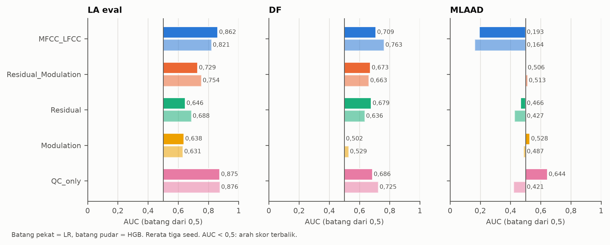
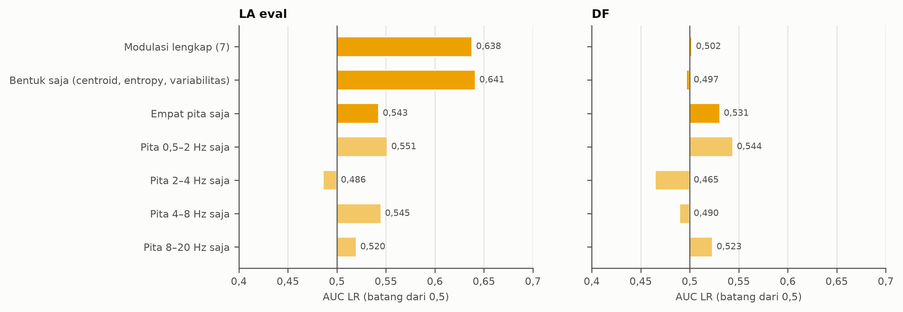
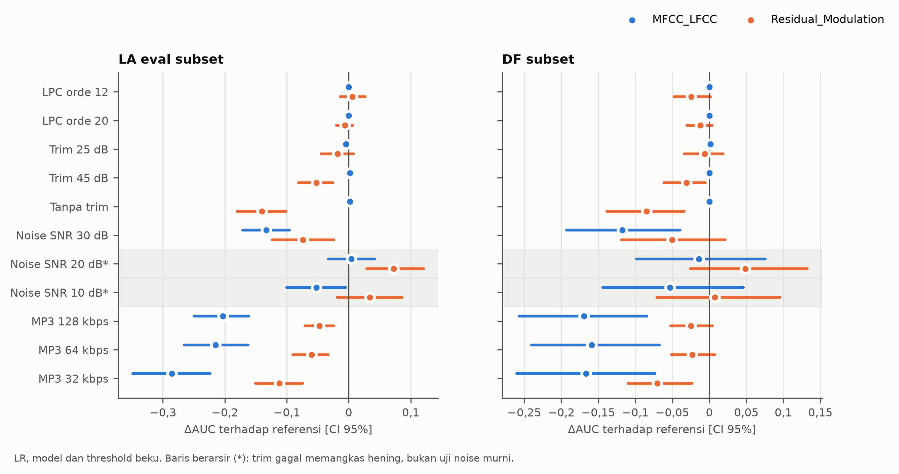
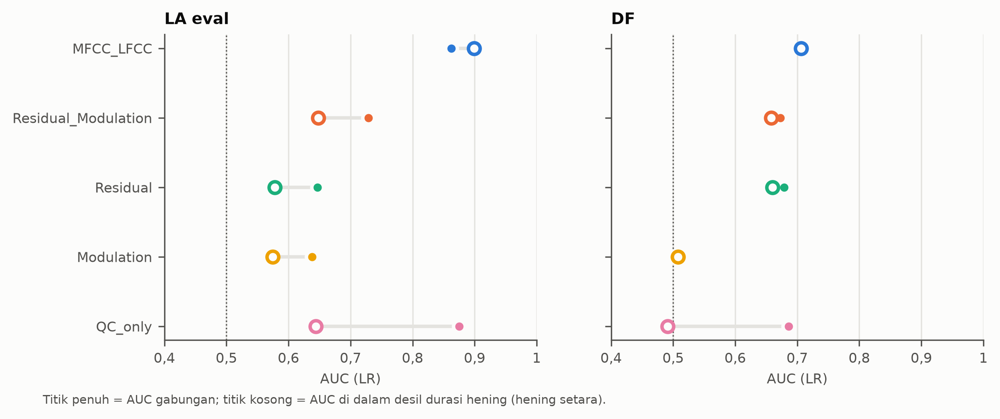

# Laporan hasil ASVspoof 2019 LA, ASVspoof 2021 DF, dan MLAAD-tiny — residual-modulasi v9

| Metadata | Nilai |
| --- | --- |
| ID laporan / versi format | `HASIL-RESMOD-V9-1d5ba7b2b9562c28` / 1.0 |
| Tanggal analisis | 2026-11-26, Asia/Jakarta |
| Tanggal/waktu eksekusi | Run utama dibuat 2026-11-25 03:00 UTC (`run_identity.json`), evaluasi selesai 13:26 WIB. Stress dan ablation pertama (`ac75de17ecbf78eb`, 2026-11-25 16:02 UTC) pada sesi Colab yang sama. Ablation pita tunggal `52760a671e6853be` dibuat 2026-11-26 06:44 UTC |
| Jenis laporan | Hasil eksperimen + analisis lanjutan (kontrol hening, stress, ablation) |
| Dataset / skenario | Pengembangan ASVspoof 2019 LA (train/dev). Uji: LA eval (internal, A07–A19), ASVspoof 2021 DF subset tersedia (eksternal), MLAAD-tiny English (eksternal). Seleksi utterance identik dengan run glottal v9 `fe17e2b856dd5d6c` |
| Pipeline / status run | `residual_modulation_v9` profil `full` / **selesai**: ekstraksi 47.373 utterance, training tiga seed, analisis hening, stress 12 kondisi, dua ablation |
| Dasar bukti | CSV/JSON asli dari cadangan Drive `backup/full/` (diunduh dengan rclone 2026-11-26). Tabel dan gambar dibangkitkan `scripts/build_bab4_assets.py` dari artefak tersebut |
| Editor / runtime | VS Code dengan kernel Colab (ekstensi Colab), CPU 2 core; Python 3.13.18, scikit-learn 1.6.1, librosa 0.11.0, numpy 2.4.6, xgboost 3.4.1 |
| Notebook / RUN_ID / seed | [notebooks/pipeline_forensic_whole_utterance_v9.ipynb](../../notebooks/pipeline_forensic_whole_utterance_v9.ipynb) / `1d5ba7b2b9562c28` / 2026, 2027, 2028 (stress: seed 2026) |
| Lokasi artefak | Drive `College/speech-deepfake-residual-modulation-new/backup/full/` (`runs/`, `checkpoints/`, `stress/`, `band_ablation/`, `features/`). Tabel/gambar Bab 4: [assets/residual_modulation_v9_1d5ba7b2b9562c28_2026-11-26](assets/residual_modulation_v9_1d5ba7b2b9562c28_2026-11-26/) |

## 1. Ringkasan eksekutif

Pipeline residual-modulasi v9 berjalan penuh pada 47.373 utterance, dan semuanya terukur (residual dan modulasi 100% di setiap dataset × kelas). Baseline MFCC/LFCC identik dengan glottal v9: MFCC-LR 0,707 dan LFCC-LR 0,839 di LA eval, sama dengan run `fe17e2b856dd5d6c`. Ini menunjukkan protokol data dan baseline kedua proyek dapat dibandingkan langsung.

**Kinerja model bukti.** Residual_Modulation mencapai AUC 0,729 (LR) / 0,754 (HGB) di LA eval dan 0,673 / 0,663 di DF. Nilai ini di atas peluang, tetapi di bawah MFCC_LFCC (LA 0,862 / 0,821; DF 0,709 / 0,763).
- Di LA, selisihnya nyata: LR −0,135 [−0,157; −0,111], HGB −0,065 [−0,087; −0,042].
- Di DF, selisih LR tidak terbukti (−0,039 [−0,115; 0,028]), sedangkan selisih HGB nyata (−0,091 [−0,168; −0,032]).
- Di MLAAD, semua model dari LA gagal: RM ≈ 0,51, dan MFCC_LFCC terbalik (0,16–0,19).

**Temuan audit terpenting: jalan pintas hening.** Durasi hening tepi yang dipangkas trim sendiri sudah memisahkan kelas: AUC 0,890 di LA eval, 0,763 di DF, dan 0,899 di MLAAD. REAL punya hening lebih panjang (median 1,35 s vs 0,34 s di LA eval). Kontrol `QC_only` mencapai 0,875 di LA, lebih tinggi dari semua sistem akustik.
- Di dalam desil hening yang setara, `QC_only` jatuh ke 0,644 (LA) / 0,491 (DF).
- MFCC_LFCC tidak terpengaruh: 0,899 di LA, malah naik.
- RM-LR turun ke 0,648 (LA) dan RM-HGB ke 0,713. Jadi sebagian sinyal RM ikut berkorelasi dengan hening.
- Menambahkan RM ke QC menaikkan AUC di DF (LR +0,077 [0,009; 0,142]) dan di LA dengan HGB (+0,017 [0,006; 0,029]). RM membawa informasi di luar metadata hening, tetapi kecil di LA.

**Kekuatan dan keterbatasan.**
- **Ketahanan MP3 (model dan threshold beku).** RM jauh lebih tahan daripada MFCC_LFCC. Di LA, MP3 128 kbps menurunkan MFCC_LFCC −0,203 [−0,250; −0,161], sedangkan RM hanya −0,047 [−0,071; −0,025]. Polanya sama di DF.
- **Kepekaan terhadap trim.** RM sensitif terhadap pengaturan trim: tanpa trim −0,140 di LA dan −0,085 di DF, sedangkan MFCC_LFCC ≈ 0.
- **Uji noise SNR 20/10 dB tidak sah sebagai uji ketahanan.** Noise ditambahkan sebelum trim, sehingga hening tidak lagi terpangkas.
- **Ablation modulasi.** Sinyal modulasi berasal dari fitur bentuk spektrum (terutama entropy), bukan energi pita. Modulasi tidak tergeneralisasi ke DF.

**Status rumusan.** RQ2 (perbedaan karakteristik) dan RQ3 (konsistensi) terjawab. RQ1 terjawab untuk LR/SVM/RF/HGB/XGB; KNN dan MLP dari panduan tidak dijalankan. Batas utama:
- DF hanya subset tersedia, 812 utterance.
- MLAAD hanya punya 3 speaker, sehingga CI tidak didukung.
- Jalan pintas hening ASVspoof 2019 LA memengaruhi semua tafsiran pada dataset ini.

## 2. Tujuan dan pertanyaan penelitian

Mengacu pada [panduan skripsi](../panduan.pdf) §2:

1. **RQ1.** Bagaimana performa SVM, Random Forest, XGBoost, KNN, dan MLP dengan MFCC dan LFCC dalam membedakan real dan deepfake?
2. **RQ2.** Karakteristik residual (energy, entropy, prediction error, excitation irregularity, kurtosis) dan fitur modulasi apa yang berbeda antara real dan deepfake?
3. **RQ3.** Apakah bukti residual-modulasi konsisten dengan skor dan keputusan baseline MFCC/LFCC pada pengujian internal, lintas speaker, dan lintas dataset?

**Hipotesis operasional (panduan):**
- **H1.** Distribusi atau effect size fitur berbeda antarkelas.
- **H2.** Model evidence-only memberi diskriminasi di atas peluang dan mempertahankan sebagian performa pada speaker-independent test.
- **H3.** Kasus yang konsisten lebih mudah dijelaskan daripada kasus yang bertentangan.

Sesuai [pemetaan v9](../AI-context/pemetaan-v9-panduan.md), protokol data mengikuti glottal v9, bukan DEEP-VOICE, atas keputusan pengguna. Model bukti tidak harus menang dari baseline; yang dinilai adalah kekuatan, kelemahan, dan kondisi berlakunya.

## 3. Sumber bukti dan identitas eksperimen

| Sumber | Isi | Status |
| --- | --- | --- |
| `runs/1d5ba7b2b9562c28/run_identity.json` | Identitas fitur `fb035f69b9a86b98…`, `feature_table_sha256 19a68665…`, `manifest_sha256 a4f3b28a…`, konfigurasi lengkap, versi paket | Dibaca |
| `runs/1d5ba7b2b9562c28/*.csv` | Metrik (624 baris), skor per utterance, bootstrap, statistik fitur, CV, permutation importance, konsistensi | Dibaca; lihat catatan checksum |
| `runs/1d5ba7b2b9562c28/analysis/` | Keluaran `run_pipeline_v9.py analyze`: AUC QC/hening, AUC terstratifikasi | Dibaca |
| `stress/1d5ba7b2b9562c28/results/` | 12 varian × 1.294 utterance, semua `ok`; ΔAUC berpasangan, perubahan fitur | Dibaca |
| `stress/1d5ba7b2b9562c28/features/<varian>/*/shards/*.csv` | Fitur QC per varian (untuk diagnosis trim pada noise) | Dibaca |
| `band_ablation/runs/ac75de17ecbf78eb` | Ablation "tanpa satu pita", 64 checksum cocok | Dibaca; desain tidak informatif (§7.1) |
| `band_ablation/runs/52760a671e6853be` | Ablation pita tunggal, 64 checksum cocok | Dibaca |

**Catatan checksum run utama.** Enam berkas evaluasi run utama tidak cocok dengan `complete.json`: `bootstrap_intervals`, `error_analysis`, `evidence_consistency`, `metrics`, `seed_summary`, dan `utterance_scores`. Berkas tersebut ditulis ulang pukul 13:26 WIB, sedangkan `complete.json` bertanggal 12:09 WIB. Penyebabnya adalah evaluasi ulang setelah restore: skor RF berbeda pada orde 1e-16, dan mirror lama hanya memeriksa ukuran berkas. Bug mirror sudah diperbaiki (`mirror_exact`, commit `40e49fd`), tetapi run ini tidak dievaluasi ulang.

Konsistensi internal diperiksa ulang dari skor tersimpan:
- AUC yang dihitung ulang dari `utterance_scores.csv` cocok dengan `metrics.csv` hingga 5,5 × 10⁻⁶.
- Rerata `metrics.csv` cocok dengan `seed_summary.csv` hingga 2 × 10⁻¹⁶.

Generator aset mencatat keenam berkas ini secara eksplisit (`--main-known-mismatch`); tidak ada yang dilewati diam-diam. Untuk paket final yang bersih, jalankan T05 tanpa `RESTORE_RUN_ID`, sehingga evaluasi dihitung ulang dari model beku (±3 jam).

**Reprodusibilitas lintas run.**
- Run ablation `52760a671e6853be` dilatih ulang dari cache fitur yang sama dan menghasilkan AUC baseline identik dengan run utama (MFCC_LFCC LR 0,862; RM LR 0,729 / HGB 0,754).
- Run awal `f43e495fc52a38ff` (tujuh keluarga, sebelum kontrol QC ditambahkan) memberi metrik keluarga bersama yang identik.

## 4. Metode dan konfigurasi

**Data.** Seleksi diimpor dari manifest glottal v9 (47.373 baris):
- **LA train:** 25.380 (2.580 bona fide).
- **LA dev:** 2.000.
- **LA eval:** 17.275 dari 67 speaker (1.675 bona fide).
- **DF:** 812 tersedia di `DF.zip` (187 bona fide, 72 speaker).
- **MLAAD-tiny English:** 1.906 berpasangan (3 narator).

Audio di-*stage* ke disk lokal Colab, dan SHA-256 tiap berkas masuk identitas cache fitur.

**Praproses (urutan v9).** Crop tengah pada laju asli (maks. 60 s), resample ke 16 kHz, trim hening tepi 35 dB, hapus DC, normalisasi RMS. Mask frame aktif memakai persentil-90 RMS − 30 dB. Frame 25 ms, hop 10 ms.

**Fitur.**
- **Residual LPC:** Burg orde 16, 15 ringkasan = {energy, entropy, prediction error, irregularity, kurtosis} × {mean, std, median}.
- **Modulasi:** amplop Hilbert, low-pass 40 Hz, laju 100 Hz, 7 fitur = energi relatif 4 pita (0,5–2, 2–4, 4–8, 8–20 Hz) + centroid, entropy, variabilitas amplop.
- **MFCC/LFCC:** 20 koefisien, static mean/std + delta std + delta2 std (80 per jenis).
- **QC (kontrol):** durasi asli, durasi dianalisis, puncak, RMS, rasio frame aktif, rasio frame residual valid.

**Model.**
- Classifier: LR (acuan), SVM-RBF, RF, HGB, XGB dengan preset tetap, ditambah GMM 64 komponen tingkat frame untuk MFCC/LFCC.
- Fitting pada train, seleksi champion dan threshold EER dari dev; semua seed dibekukan sebelum evaluasi.
- Komposit `QC_plus_*` didefinisikan di config agar cache fitur tidak berubah.

**Statistik.**
- Rerata ± SD tiga seed.
- CI 95% selisih AUC: bootstrap persentil berpasangan berklaster speaker, 1.000 draw, minimal 5 speaker. MLAAD tidak didukung.
- Mann–Whitney U, rank-biserial, dan BH-FDR pada LA train.
- CV 5-fold berkelompok speaker di train.
- Konsistensi: Spearman, agreement, kappa, dan empat kategori galat.

**Analisis hening** (`analyze`, tanpa training ulang): AUC per kuantitas QC, lalu AUC tiap sistem di dalam 10 bin kuantil durasi hening atau durasi dianalisis, dirata-rata berbobot (minimal 5 per kelas per bin).

**Stress (E2).**
- Subset tetap: 1 utterance per sel speaker × serangan (LA 691, DF 416, MLAAD 187).
- Model seed 2026 dan threshold dev dibekukan; GMM tidak diuji.
- Varian: LPC 12/20, trim 25/45 dB, tanpa trim, noise putih SNR 30/20/10 dB, dan MP3 128/64/32 kbps (libmp3lame lalu didekode kembali).

**Ablation (E3).** Training ulang dengan resep sama dari cache fitur yang sama; GMM dimatikan pada ablation kedua.

## 5. Audit data dan kualitas pengukuran

Tabel lengkap: [Tabel 4.1](assets/residual_modulation_v9_1d5ba7b2b9562c28_2026-11-26/tabel_bab4.md#tabel-41-komposisi-data-cakupan-pengukuran-dan-durasi).

- **Cakupan 100%.** Residual dan modulasi terukur untuk semua 47.373 utterance, tidak ada kegagalan ekstraksi, dan target cakupan residual 95% di panduan terpenuhi. Complete-case RM identik dengan hasil utama.
- **Kebocoran.** `leakage_audit.json`: speaker internal terpisah antar split; tidak ada speaker development yang muncul di eksternal.
- **Hening tepi berbeda antarkelas di semua dataset.** Median hening terpangkas REAL vs FAKE:

  | Dataset | REAL | FAKE |
  | --- | --- | --- |
  | LA eval | 1,35 s | 0,34 s |
  | DF | 0,74 s | 0,38 s |
  | MLAAD | 0,98 s | 0,30 s |

  Ini artefak pembuatan dataset, bukan karakteristik produksi suara (§7.4).
- **Serangan yang sudah dikenal.** A16 dan A19 di LA eval memakai algoritma yang sama dengan A04 dan A06 di train.

## 6. Hasil utama

Tabel 4.3–4.5 di [tabel_bab4.md](assets/residual_modulation_v9_1d5ba7b2b9562c28_2026-11-26/tabel_bab4.md) memuat semua keluarga dengan LR, HGB, dan GMM, termasuk EER, BA, F1, FPR, dan FNR. Ringkasan AUC (rerata tiga seed; threshold beku dari dev):

| Keluarga | LA eval LR | LA eval HGB | DF LR | DF HGB | MLAAD LR | MLAAD HGB |
| --- | --- | --- | --- | --- | --- | --- |
| MFCC | 0,707 | 0,729 | 0,732 | 0,749 | 0,665 | 0,775 |
| LFCC | 0,839 | 0,791 | 0,701 | 0,705 | 0,238 | 0,174 |
| MFCC_LFCC | **0,862** | 0,821 | 0,709 | 0,763 | 0,193 | 0,164 |
| MFCC-GMM / LFCC-GMM | 0,773 / 0,860 | — | 0,776 / 0,655 | — | 0,678 / 0,253 | — |
| Residual | 0,646 | 0,688 | 0,679 | 0,636 | 0,466 | 0,427 |
| Modulation | 0,638 | 0,631 | 0,502 | 0,529 | 0,528 | 0,487 |
| **Residual_Modulation** | 0,729 | 0,754 | 0,673 | 0,663 | 0,506 | 0,513 |
| QC_only (kontrol) | 0,875 | 0,876 | 0,686 | 0,725 | 0,644 | 0,421 |
| QC + Residual_Modulation | 0,867 | 0,894 | 0,765 | 0,773 | 0,633 | 0,525 |
| QC + MFCC_LFCC | 0,888 | 0,835 | 0,718 | 0,774 | 0,198 | 0,166 |



**RQ1 — classifier pada baseline.** AUC MFCC_LFCC di LA eval / DF:

| Classifier | LA eval | DF |
| --- | --- | --- |
| LR | 0,862 | 0,709 |
| SVM-RBF | 0,851 | 0,693 |
| XGB | 0,834 | 0,781 |
| HGB | 0,821 | 0,763 |
| RF | 0,805 | 0,761 |

Hasil dev hampir sempurna (0,985–0,998). Penurunan ke eval berasal dari serangan yang tidak terlihat (A07–A19). SVM-RBF menjadi champion dev (AUC 0,998), tetapi di eval kalah dari LR. Di DF, model pohon (XGB/HGB/RF) lebih baik daripada LR/SVM. KNN dan MLP tidak dijalankan: keduanya tersedia di config tetapi bukan default v9.

**Bacaan.**
- **RM di atas peluang di LA dan DF (H2 didukung sebagian).** CV speaker-independent di train memberi AUC RM-LR 0,817–0,889 per fold, dibanding MFCC_LFCC 0,959–0,994.
- **Transfer LA → DF.** Penurunan RM (0,729 → 0,673) lebih kecil daripada MFCC_LFCC-LR (0,862 → 0,709), tetapi MFCC_LFCC tetap lebih tinggi.
- **Peran residual dan modulasi berbeda per dataset.** Residual saja (0,679) setara RM di DF, sedangkan modulasi di DF ≈ 0,50. Di LA, gabungan lebih baik daripada masing-masing bagian.
- **MLAAD.** Tidak ada sistem LA yang berhasil. LFCC dan MFCC_LFCC terbalik; ini sifat data yang juga terlihat di glottal v9. Arah skor tidak dibalik post hoc.

## 7. Analisis tambahan

### 7.1 Ablation domain dan pita modulasi (E3, RQ2)

**Domain** (run utama): Residual saja 0,646 / 0,688 dan Modulation saja 0,638 / 0,631 di LA (LR / HGB). Gabungan 0,729 / 0,754 lebih tinggi dari masing-masing.

Grouped permutation importance RM-LR (penurunan AUC, [Tabel 4.9](assets/residual_modulation_v9_1d5ba7b2b9562c28_2026-11-26/tabel_bab4.md#tabel-49-grouped-permutation-importance-residual_modulation-lr-seed-2026)):

| Kelompok diacak | LA | DF | MLAAD |
| --- | --- | --- | --- |
| Residual | 0,149 | 0,171 | −0,038 |
| Modulasi | 0,087 | 0,006 | +0,038 |

Di DF, prediksi bergantung hampir seluruhnya pada residual.

**Ablation pertama (`ac75de17ecbf78eb`) tidak informatif.** Menghapus satu pita tidak mengubah apa pun (Modulation LR 0,638 → 0,638–0,641). Keempat energi pita adalah proporsi yang berjumlah ≈ 1 (median 0,992 di data penuh), sehingga pita yang dihapus dapat direkonstruksi dari tiga sisanya. Desain diganti menjadi pita tunggal (`column_families`, commit `60b2bc7`).

**Ablation pita tunggal (`52760a671e6853be`)**, lihat Tabel 4.14–4.15:

| Model (LR) | LA eval | DF | MLAAD |
| --- | --- | --- | --- |
| Modulasi lengkap (7 fitur) | 0,638 | 0,502 | 0,528 |
| Bentuk saja (centroid, entropy, variabilitas) | 0,641 | 0,497 | 0,529 |
| Empat pita saja | 0,543 | 0,531 | 0,543 |
| Pita 0,5–2 Hz saja | 0,551 | 0,544 | 0,535 |
| Pita 2–4 Hz saja | 0,486 | 0,465 | 0,570 |
| Pita 4–8 Hz saja | 0,545 | 0,490 | 0,555 |
| Pita 8–20 Hz saja | 0,520 | 0,523 | 0,485 |



- **Di LA, informasi modulasi ada pada bentuk spektrum.**
  - Lengkap − bentuk saja: −0,003 [−0,006; −0,001]. Pita tidak menambah apa pun di atas fitur bentuk.
  - Lengkap − pita saja: +0,095 [0,081; 0,110].
  - `mod_entropy_nats` sendiri mencapai AUC 0,633. Korelasinya dengan durasi hening lemah (Spearman −0,13 di LA eval), sehingga kemungkinan besar bukan proksi hening.
- **Tiap pita sendirian lemah** (0,49–0,55).
  - Pita 0,5–2 Hz dan 4–8 Hz masing-masing setara keempat pita (selisih ≈ 0, CI memuat 0).
  - Pita 2–4 Hz paling tidak berguna: empat pita lebih baik +0,057 [0,032; 0,083] di LA dan +0,067 [0,005; 0,132] di DF.
- **Di DF, semua varian modulasi ≈ peluang.** Bukti modulasi tidak tergeneralisasi lintas dataset.

### 7.2 Sensitivitas: konfigurasi dan kondisi audio (E2)

Model seed 2026 dan threshold dev dibekukan. AUC referensi pada subset: LA MFCC_LFCC 0,873, RM 0,781, QC 0,883; DF 0,769 / 0,649 / 0,758. Tabel lengkap dengan CI: Tabel 4.11–4.13.

**ΔAUC terhadap referensi, LR [CI 95% bootstrap berklaster speaker]:**

| Varian | LA MFCC_LFCC | LA RM | DF MFCC_LFCC | DF RM |
| --- | --- | --- | --- | --- |
| LPC orde 12 | 0 | +0,006 [−0,014; 0,027] | 0 | −0,024 [−0,048; 0,001] |
| LPC orde 20 | 0 | −0,006 [−0,020; 0,006] | 0 | −0,012 [−0,030; 0,004] |
| Trim 25 dB | −0,005 [−0,010; 0,000] | −0,018 [−0,045; 0,008] | +0,002 | −0,006 [−0,034; 0,019] |
| Trim 45 dB | +0,002 | −0,053 [−0,081; −0,026] | 0,000 | −0,031 [−0,061; −0,005] |
| Tanpa trim | +0,002 | −0,140 [−0,180; −0,101] | 0,000 | −0,085 [−0,138; −0,034] |
| Noise SNR 30 dB | −0,133 [−0,171; −0,096] | −0,074 [−0,123; −0,024] | −0,118 [−0,193; −0,039] | −0,050 [−0,118; 0,021] |
| Noise SNR 20 dB\* | +0,004 | +0,073 [0,029; 0,121] | −0,014 | +0,049 [−0,026; 0,132] |
| Noise SNR 10 dB\* | −0,052 [−0,100; −0,005] | +0,034 [−0,019; 0,086] | −0,053 | +0,007 |
| MP3 128 kbps | −0,203 [−0,250; −0,161] | −0,047 [−0,071; −0,025] | −0,169 [−0,257; −0,084] | −0,025 [−0,052; 0,004] |
| MP3 64 kbps | −0,215 [−0,265; −0,163] | −0,060 [−0,090; −0,033] | −0,159 [−0,240; −0,068] | −0,023 [−0,051; 0,008] |
| MP3 32 kbps | −0,286 [−0,348; −0,224] | −0,112 [−0,151; −0,074] | −0,167 [−0,260; −0,074] | −0,070 [−0,110; −0,024] |

"0" berarti varian itu tidak mengubah fitur keluarga tersebut (orde LPC tidak dipakai MFCC/LFCC).



**Bacaan.**
- **MP3 adalah kekuatan RM yang paling jelas.**
  - Pada 128 kbps di LA, RM (0,734) sudah di atas MFCC_LFCC (0,670).
  - Pada threshold beku, BA MFCC_LFCC jatuh ke 50,0% pada semua bitrate MP3, artinya hampir semua utterance masuk satu kelas. RM bertahan di 58–64% (Tabel 4.13).
  - Penjelasan yang konsisten: MP3 membuang komponen frekuensi tinggi, tempat LFCC beresolusi tinggi, sedangkan residual LPC dan amplop modulasi lebih bergantung pada struktur pita rendah dan waktu.
- **Orde LPC 12–20 tidak berpengaruh berarti.** Semua CI ΔAUC RM memuat 0 (paling dekat: DF LPC 12, −0,024 [−0,048; 0,001]).
- **Trim adalah kelemahan RM.** Tanpa trim, RM turun −0,140 (LA) / −0,085 (DF), dan Residual saja −0,195 di LA. MFCC_LFCC tidak berubah. Fitur residual dan modulasi dihitung juga pada frame tepi, sehingga hening yang tidak dipangkas mengubah ringkasannya. Ini konsisten dengan penurunan RM di dalam desil hening (§7.4).
- **Noise SNR 20/10 dB tidak dapat ditafsirkan sebagai ketahanan.** Fitur QC per varian menunjukkan:
  - Pada SNR 20 dan 10 dB, durasi hening terpangkas menjadi 0 untuk kedua kelas dan rasio frame aktif 1,0. Noise putih global mengangkat lantai sinyal di atas ambang trim 35 dB.
  - Pada SNR 30 dB, trim masih bekerja (median hening REAL 1,14 s).
  - Akibatnya, `QC_only` kehilangan petunjuk hening (AUC 0,40–0,46, terbalik). Residual justru naik +0,165, karena kini ikut menganalisis hening bernoise yang lebih panjang pada REAL.

  Ini interaksi noise × trim, dan sekaligus bukti tambahan bahwa residual peka terhadap isi hening. Uji noise yang sah hanya SNR 30 dB. Di sana RM turun −0,074 (LA), lebih kecil dari MFCC_LFCC −0,133.
- **Pola yang sama dilaporkan di glottal v9** (laporan 2026-11-17 §7.2: kenaikan AUC tidak monoton pada noise 20/10 dB). Diagnosis di sini menunjukkan mekanismenya: trim gagal.

### 7.3 Ketidakpastian dan perbandingan berpasangan

Selisih AUC berpasangan (seed 2026, utterance identik, bootstrap berklaster speaker, 1.000 draw). Lengkap di Tabel 4.6.

| Data (speaker) | A − B | Classifier | ΔAUC [CI 95%] |
| --- | --- | --- | --- |
| LA eval (67) | Residual_Modulation − MFCC_LFCC | LR | −0,135 [−0,157; −0,111] |
| LA eval | Residual_Modulation − MFCC_LFCC | HGB | −0,065 [−0,087; −0,042] |
| LA eval | Champion RM-RF − champion MFCC_LFCC-SVM | — | −0,155 [−0,182; −0,125] |
| LA eval | QC+RM − QC | LR | −0,008 [−0,019; 0,003] |
| LA eval | QC+RM − QC | HGB | +0,017 [0,006; 0,029] |
| LA eval | QC+MFCC_LFCC − QC | LR | +0,013 [−0,004; 0,029] |
| LA eval | QC+MFCC_LFCC − QC | HGB | −0,040 [−0,058; −0,025] |
| DF (72) | Residual_Modulation − MFCC_LFCC | LR | −0,039 [−0,115; 0,028] |
| DF | Residual_Modulation − MFCC_LFCC | HGB | −0,091 [−0,168; −0,032] |
| DF | QC+RM − QC | LR | +0,077 [0,009; 0,142] |
| DF | QC+RM − QC | HGB | +0,049 [−0,018; 0,105] |
| DF | QC+MFCC_LFCC − QC | LR | +0,030 [−0,058; 0,130] |
| DF | QC+MFCC_LFCC − QC | HGB | +0,050 [−0,030; 0,130] |

- **SD antar-seed kecil** (≤ 0,011 AUC untuk classifier non-GMM di LA dan DF; GMM hingga 0,028). Variasi speaker jauh lebih besar daripada variasi seed.
- **DF punya 72 speaker tetapi hanya 812 utterance**, sehingga CI lebar (±0,07). Selisih yang CI-nya memuat 0 berarti "tidak terbukti berbeda", bukan "setara".
- **Kontrol QC paling informatif di DF.** RM menambah informasi di atas QC (LR +0,077), sedangkan MFCC_LFCC tidak terbukti menambah. Di LA, MFCC_LFCC+QC dengan HGB lebih buruk dari QC saja (−0,040); penyebabnya belum diuji (kemungkinan kombinasi 166 fitur dengan HGB dangkal kurang memanfaatkan QC).

### 7.4 Jalan pintas hening dan kondisi evaluasi



**AUC di dalam desil durasi hening**, yaitu pembanding REAL vs FAKE dengan hening setara ([Tabel 4.8](assets/residual_modulation_v9_1d5ba7b2b9562c28_2026-11-26/tabel_bab4.md#tabel-48-kontrol-jalan-pintas-hening-auc-gabungan-vs-di-dalam-strata)):

| Sistem | LA gabungan | LA dalam desil hening | DF gabungan | DF dalam desil hening |
| --- | --- | --- | --- | --- |
| QC_only LR | 0,875 | 0,644 | 0,686 | 0,491 |
| MFCC_LFCC LR | 0,862 | 0,899 | 0,709 | 0,706 |
| Residual_Modulation LR | 0,729 | 0,648 | 0,673 | 0,658 |
| Residual_Modulation HGB | 0,754 | 0,713 | 0,663 | 0,649 |
| Residual LR | 0,646 | 0,578 | 0,679 | 0,660 |
| Modulation LR | 0,638 | 0,575 | 0,502 | 0,508 |

- **QC_only hampir seluruhnya dijelaskan oleh hening.** Di DF ia jatuh ke peluang. Di LA tersisa 0,644 dari kuantitas QC lain, misalnya durasi.
- **MFCC_LFCC tidak menunggangi hening.** AUC-nya tetap atau naik di dalam strata.
- **RM sebagian berkorelasi dengan hening di LA** (−0,04 s.d. −0,08), tetapi tetap jauh di atas peluang (0,65–0,71). Di DF, RM hampir tidak berubah (−0,01). Bersama hasil stress trim dan kontrol QC+RM, ini menunjukkan sebagian sinyal residual-modulasi di LA terkait penanganan hening tepi. Sisanya merupakan informasi akustik yang bertahan setelah hening dikendalikan.
- **Batas analisis ini.** Bin diambil dari data target dan tidak ada interval. Analisis bersifat deskriptif dan tidak dipakai untuk memilih model.

**Per serangan** (champion dev, Tabel 4.7). MFCC_LFCC-SVM nyaris sempurna pada A07–A09, A16, dan A19 (≥ 0,999), tetapi gagal pada A12 (0,320, terbalik), A13 (0,557), dan A10 (0,601). Champion RM-RF lebih merata (0,57–0,90) dan lebih baik justru pada A12 (+0,329), A13 (+0,271), dan A10 (+0,031). Pola saling melengkapi ini sama dengan temuan G3 di glottal v9 (A12–A14).

### 7.5 RQ2: karakteristik residual dan modulasi

Mann–Whitney deskriptif di LA train (Tabel 4.2; rank-biserial + = FAKE lebih tinggi). Semua fitur berbeda nyata setelah BH-FDR, kecuali `res_kurtosis_std` (q = 0,125) dan `mod_band_2_4` (q = 0,417).

| Karakteristik | Arah pada FAKE | Effect size terbesar |
| --- | --- | --- |
| Energi residual | lebih rendah | mean −0,349, std −0,323 |
| Entropy residual | lebih rendah | median −0,344, mean −0,301 |
| Prediction error | lebih rendah | median −0,362 |
| Excitation irregularity | lebih rendah, variasi lebih kecil | std −0,384 |
| Kurtosis residual | lebih tinggi | median +0,398, mean +0,371 |
| Energi pita 0,5–2 Hz | lebih rendah | −0,097 |
| Energi pita 8–20 Hz, centroid | lebih tinggi | +0,139, +0,138 |
| Entropy modulasi | lebih tinggi | +0,191 |

**Tafsiran.**
- **Residual.** Ucapan sintetis lebih dapat diprediksi oleh LPC: error dan energi residual lebih rendah. Residualnya lebih runcing (kurtosis tinggi) dan lebih teratur (irregularity rendah). Ini konsisten dengan eksitasi vokoder yang lebih periodik/impulsif dan kurang derau aspirasi dibanding eksitasi glotis manusia.
- **Modulasi.** Energi modulasi FAKE bergeser dari ritme lambat (0,5–2 Hz, setingkat frasa) ke modulasi cepat (8–20 Hz), dengan spektrum modulasi lebih datar (entropy lebih tinggi).
- **Besar efek.** Semua efek kecil–sedang (|r| ≤ 0,40). Utterance dalam satu speaker tidak independen, sehingga q bersifat deskriptif. CI median selisih memakai bootstrap berklaster speaker (kolom `median_ci_*` di `statistical_tests.csv`).

Gambar distribusi fitur LA eval: [gambar_4_3](assets/residual_modulation_v9_1d5ba7b2b9562c28_2026-11-26/figures/gambar_4_3_distribusi_fitur_la_eval.png). Spektrum modulasi rerata per kelas dengan CI: [gambar_4_4](assets/residual_modulation_v9_1d5ba7b2b9562c28_2026-11-26/figures/gambar_4_4_spektrum_modulasi_la_eval.png).

### 7.6 RQ3: konsistensi bukti dan baseline

Champion dev: MFCC_LFCC SVM-RBF (baseline) dan Residual_Modulation RF (bukti). Rerata tiga seed pada threshold beku ([Tabel 4.10](assets/residual_modulation_v9_1d5ba7b2b9562c28_2026-11-26/tabel_bab4.md#tabel-410-konsistensi-keputusan-champion-baseline-mfcc_lfcc-svm-dan-bukti-rm-rf)):

| Data | Spearman ρ | Agreement | Kappa | Keduanya benar | Hanya baseline benar | Hanya RM benar | Keduanya salah |
| --- | --- | --- | --- | --- | --- | --- | --- |
| LA dev | 0,365 | 81,8% | 0,566 | 81,8% | 15,6% | 2,6% | 0,1% |
| LA eval | 0,111 | 51,9% | 0,044 | 26,8% | 33,4% | 14,7% | 25,1% |
| DF | 0,102 | 56,8% | 0,074 | 43,1% | 27,8% | 15,4% | 13,7% |
| MLAAD | 0,085 | 61,7% | 0,055 | 14,2% | 6,3% | 31,9% | 47,6% |

- **Konsistensi hanya pada data yang dikenal.** Di dev (serangan sama dengan train), keputusan kedua jalur cukup konsisten (κ 0,57). Pada serangan baru dan data eksternal, konsistensinya hampir nol (κ ≤ 0,07, ρ ≈ 0,1). Kedua jalur memakai informasi yang berbeda.
- **Kasus "hanya RM benar"** sebanyak 15% di LA eval dan DF, dan 32% di MLAAD. RM memberi informasi pelengkap, terutama pada serangan yang lolos dari baseline (A10, A12, A13).
- **H3 belum dapat dinilai secara kuantitatif.** Kategori galat tersedia per utterance (`error_analysis.csv`, gambar [G7](assets/residual_modulation_v9_1d5ba7b2b9562c28_2026-11-26/figures/gambar_4_7_kategori_error_la_eval.png)), tetapi penilaian "lebih mudah dijelaskan" memerlukan telaah contoh kasus secara kualitatif.

## 8. Interpretasi terhadap penelitian

| Pertanyaan | Bukti yang mendukung | Status jawaban / batas |
| --- | --- | --- |
| RQ1: performa classifier MFCC/LFCC | LA eval 0,805–0,862, DF 0,693–0,781; LR terbaik di LA, model pohon di DF; MLAAD gagal (terbalik) | Terjawab untuk LR/SVM/RF/HGB/XGB + GMM; KNN/MLP tidak dijalankan |
| RQ2: karakteristik residual-modulasi yang berbeda | 20 dari 22 fitur berbeda (q < 0,05), efek kecil–sedang; arah konsisten dengan eksitasi sintetis yang lebih teratur; modulasi bergeser ke laju cepat | Terjawab (deskriptif, LA train); sebagian efek di LA terkait penanganan hening |
| H2: evidence-only di atas peluang | RM 0,729–0,754 (LA), 0,663–0,673 (DF), CV speaker 0,82–0,89; tetap 0,65–0,71 di dalam desil hening LA | Didukung untuk LA dan DF; tidak untuk MLAAD |
| RQ3: konsistensi dengan baseline | κ 0,57 di dev, ≤ 0,07 di eval/eksternal; RM benar sendiri pada 15–32% kasus | Terjawab: konsisten pada kondisi yang dikenal, tidak konsisten (saling melengkapi) pada serangan baru |
| Kondisi berlakunya bukti (E2/E3) | Tahan MP3 jauh lebih baik dari MFCC_LFCC; peka trim; modulasi hanya berguna di LA, lewat entropy/bentuk | Didukung pada subset stress dengan model beku; noise SNR ≤ 20 dB tidak sah |

**Pernyataan naskah yang sesuai kekuatan bukti:**
- "Model residual-modulasi memberi diskriminasi di atas peluang pada LA (AUC 0,73–0,75) dan DF (0,66–0,67), tetapi di bawah baseline MFCC/LFCC."
- "Bukti residual jauh lebih tahan kompresi MP3 daripada MFCC/LFCC pada threshold yang dibekukan."
- "Keputusan kedua jalur hampir tidak berkorelasi pada serangan baru, sehingga residual-modulasi berpotensi sebagai bukti pelengkap."

**Pernyataan yang tidak didukung:**
- Residual-modulasi lebih baik daripada MFCC/LFCC.
- Bukti tergeneralisasi ke MLAAD.
- Karakteristik residual membuktikan mekanisme produksi suara secara kausal.

## 9. Keterbatasan dan status kesimpulan

- **Jalan pintas hening ASVspoof 2019 LA.** Durasi hening saja mencapai AUC 0,89. Fitur dihitung setelah trim, tetapi RM tetap sebagian berkorelasi dengan hening (§7.4) dan peka terhadap ambang trim (§7.2). Klaim kinerja RM di LA harus disertai angka di dalam desil hening.
- **DF hanya subset tersedia** (812 dari 2.968 terpilih); CI lebar.
- **MLAAD hanya 3 speaker.** CI tidak didukung dan semua sistem LA gagal; hasil MLAAD bersifat deskriptif.
- **Uji noise SNR 20/10 dB terkontaminasi** kegagalan trim. Memperbaikinya (noise setelah trim) mengubah `channels.py`, modul identitas cache fitur, sehingga perlu ekstraksi ulang ±5 jam. Hal ini tidak dilakukan.
- **Stress memakai satu seed dan subset kecil** (691 LA, 416 DF), dengan model beku tanpa GMM.
- **Statistik fitur bersifat deskriptif.** MWU mengabaikan ketergantungan utterance dalam speaker.
- **KNN/MLP tidak dijalankan.** Residual memakai LPC Burg, bukan solver Wiener-Hopf eksplisit; protokol data mengikuti glottal v9, bukan DEEP-VOICE pada panduan.
- **Checksum run utama** tidak cocok untuk 6 berkas evaluasi (§3); angka terverifikasi konsisten dengan skor tersimpan.

## 10. Rekomendasi dan tindak lanjut

| Prioritas | Tindakan | Alasan | Keluaran yang diperlukan |
| --- | --- | --- | --- |
| P1 | Tulis Bab 4 dari tabel/gambar aset ini | Bukti untuk ketiga RQ sudah tersedia | Naskah Bab 4 |
| P2 | Evaluasi ulang run utama (T05 tanpa `RESTORE_RUN_ID`, ±3 jam) | Menghasilkan paket dengan checksum bersih untuk lampiran | `complete.json` cocok |
| P3 | Telaah kualitatif contoh kategori "hanya RM benar" / "hanya baseline benar" | Menilai H3 | Contoh waveform/residual per kategori |
| Opsional | Uji noise setelah trim | Menggantikan SNR 20/10 dB yang tidak sah | Re-ekstraksi penuh (±5 jam) + stress |
| Opsional | KNN/MLP pada baseline | Kelengkapan RQ1 sesuai panduan | Run baru (config `models`) |

## 11. Artefak serta verifikasi laporan

- **Tabel Bab 4 (15 tabel):** [tabel_bab4.md](assets/residual_modulation_v9_1d5ba7b2b9562c28_2026-11-26/tabel_bab4.md), dengan CSV per tabel di `tables/`.
- **Gambar (10 PNG, 300 dpi):** di `figures/`. Gambar 4.0 dan 4.3–4.7 adalah salinan G1/G3/G4/G5/G7 pipeline. Gambar 4.1, 4.2, 4.8, dan 4.9 dibuat generator dengan palet kategorikal yang tervalidasi (CVD ΔE ≥ 9,1); nilai disertakan sebagai label atau tabel.
- **Hash sumber:** `sha256_sumber.txt`, mencakup semua CSV/JSON run yang dibaca generator.
- **Pemeriksaan yang dilakukan:**
  - 64 checksum ablation cocok.
  - Keenam ketidakcocokan run utama dicatat.
  - AUC dihitung ulang dari skor (selisih ≤ 5,5 × 10⁻⁶).
  - Arah perbandingan berpasangan diperiksa silang: MFCC_LFCC-LR − RM-LR +0,135 sama dengan RM − MFCC_LFCC (LR) −0,135.
  - Kegagalan trim pada noise diverifikasi dari fitur QC per varian.
- **Pembangkitan ulang aset:**

  ```bash
  python scripts/build_bab4_assets.py --main backup/full/runs/1d5ba7b2b9562c28 --stress backup/full/stress/1d5ba7b2b9562c28/results --ablation backup/full/band_ablation/runs/52760a671e6853be --out docs/AI-research/assets/residual_modulation_v9_1d5ba7b2b9562c28_2026-11-26 --main-known-mismatch bootstrap_intervals.csv error_analysis.csv evidence_consistency.csv metrics.csv seed_summary.csv utterance_scores.csv
  ```

## Lampiran A. Hasil lengkap

Semua keluarga × classifier × skenario: `seed_summary.csv` run utama (Drive) dan Tabel 4.3–4.5. Metrik per seed dan per serangan/codec/generator: `metrics.csv` (kolom `panel_attack`). Seluruh varian stress untuk lima sistem: `stress/.../results/metrics.csv` dan `variant_paired_intervals.csv`.
